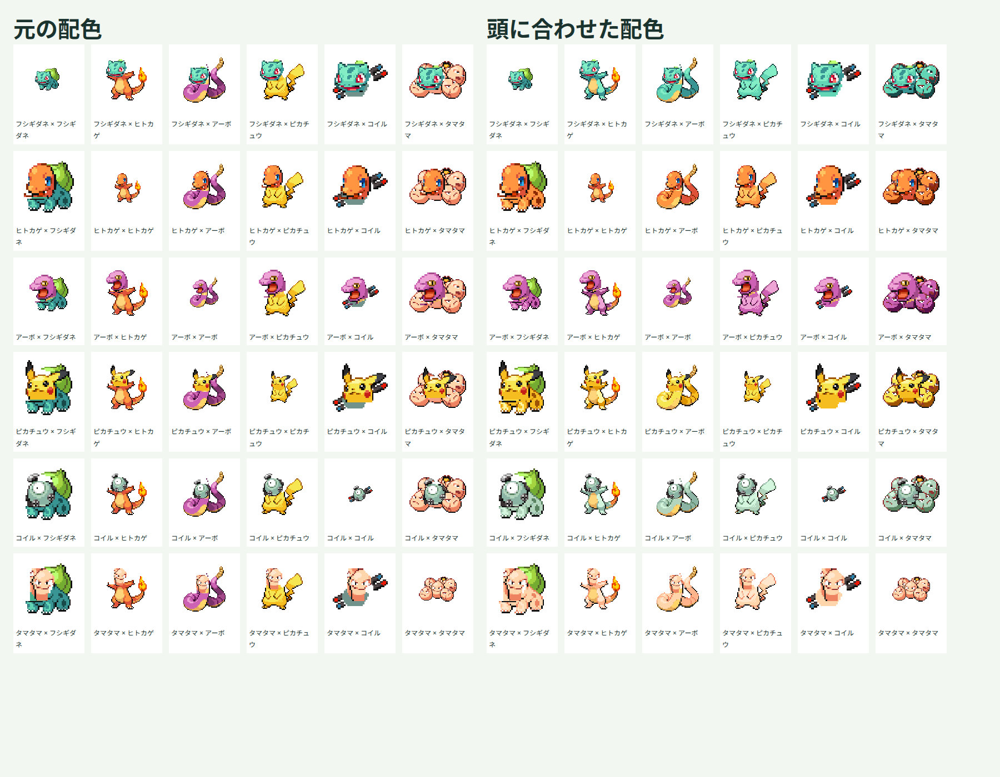

# 体の配色を頭に合わせる試作

## 対象と画面

部位素材を用意した第1〜第9世代1025種類で、体の皮膚色を頭の配色へ寄せます。画面の「体の色を頭に合わせる」を初期状態でオンにし、オフにすると体の元の配色で表示します。検索、選択、ランダム、交換を行っても設定を維持します。同種同士は設定に関係なく元画像をそのまま使います。

## 変換対象の指定

src/data/fusion-masks.jsonに、各種の頭の皮膚色、体の皮膚色と、体の保護領域を定義します。体素材で指定したRGBに一致し、保護領域の外にある可視ピクセルだけを変換対象とします。変換対象の位置は、切り出した体素材のピクセル番号としてsrc/data/fusion-parts.jsonへ保存します。

黒い輪郭、目の白、別の色の模様は変換色に含めません。ヒトカゲの炎は、皮膚と同じRGBが使われる部分もあるため、領域全体を保護します。フシギダネの背中の植物、アーボの腹側、コイルの磁石の赤と青なども元の色を保ちます。ピカチュウの尾は体と同じ皮膚色として扱います。タマタマの体側に残る卵の殻は変換し、目の白や口などは保持します。

元画像と部位PNGは変更しません。補完した接続部分の色も体の皮膚色に含めて変換します。全1025種類に一律にこの色判定を適用することはせず、種ごとの配色・保護領域を定義する必要があります。

## 変換規則

変換元と変換先の配色をRGBの明るさ順に並べます。比較には`R×299 + G×587 + B×114`を使います。変換元での段階に対応する、変換先の近い段階の色へ置換します。変換元が1色だけの場合は、変換先の中央の段階を使います。暗い色を明るい色より上の段階へ割り当てないようにします。ただし段階数が異なる場合、複数の色が同じ色へまとまることがあります。

体素材のピクセルを複製して変換し、アルファ値と変換対象外のRGBを保持します。変換済みの体をCanvasへ描画し、その前に元の頭素材を重ねます。変換は素材の元の寸法で行い、拡大縮小では補間を無効にします。

不正なRGB、重複した色、範囲外のピクセル番号や配色と一致しない可視ピクセルは失敗として扱います。変換元は1色以上、変換先は2色以上を必要とします。素材生成・検証では、指定した色が素材内に存在することと、生成した対象ピクセルが定義と一致することも確認します。

## 確認方法

実装前に、明暗順の置換、対象外と透過の保持、元データを変えないこと、不正な配色とピクセル番号を拒否することをテストします。画面では初期のオン状態、切り替え後の再描画と選択の維持をテストします。

実ブラウザで36通りを確認し、同種同士の元画像の保持、異種の変換前後、描画順と余白を確認します。炎など保護した部分のピクセルは、変換前後で一致することを確認します。操作画面はスマートフォン幅とデスクトップ幅で、切り替え、検索、交換、読み込み失敗と再試行を確認します。

配色の段階の統合、残る模様と新しい皮膚色の組み合わせ、接続部の補完の露出は目視で評価します。配色が揃っても、全種への部位対応や接続品質の完成とはしません。

Canvasのピクセル操作は[getImageData](https://developer.mozilla.org/en-US/docs/Web/API/CanvasRenderingContext2D/getImageData)と[putImageData](https://developer.mozilla.org/en-US/docs/Web/API/CanvasRenderingContext2D/putImageData)を使います。

## 最初の6種類での確認結果と残る課題

自動テスト63件、型検査、ビルドと部位素材の検証が成功しました。

Edgeで、6種類の36通りをオン・オフの両方で描画しました。同種同士6通りはどちらの設定でも元画像のピクセルと一致しました。異種30通りでは、すべて体の色が変化しました。変わったピクセルは指定した体の領域内だけで、対象外のピクセルとアルファ値は変化しませんでした。炎や磁石など、保護した領域の色も保持できています。

幅360pxと1280pxで、配色変換をオンにした画面の検索・ランダム・交換、キーボード選択、画像の読み込み失敗と再試行を確認しました。横方向のはみ出しとJavaScript例外はなく、文字のコントラスト比は最小約6.1対1でした。

目視では体の皮膚色を頭に寄せられています。次の点は引き続き調整が必要です。

- 明暗の段階数が減り、細かな陰影がまとまる組み合わせがあります。
- 皮膚と同じRGBを使う模様は、別の保護領域を指定しない限り色も変わります。
- 変換対象外の植物や腹側の色と、新しい皮膚色の組み合わせは個別に評価する必要があります。
- 接続部の単色の補完、タマタマの切り出し、頭の向きは配色変換では改善しません。

全1025種類に部位・配色を定義しています。全組み合わせの品質調整と、Firefoxでの確認は今後の作業です。

拡張と確認結果は[第1世代のサンプル](generation-one.md)、[第2世代の追加](generation-two.md)、[第3世代の追加](generation-three.md)、[第4世代の追加](generation-four.md)、[第5世代の追加](generation-five.md)、[第6世代の追加](generation-six.md)、[第7世代の追加](generation-seven.md)、[第8世代の追加](generation-eight.md)、[第9世代の追加](generation-nine.md)を参照してください。
