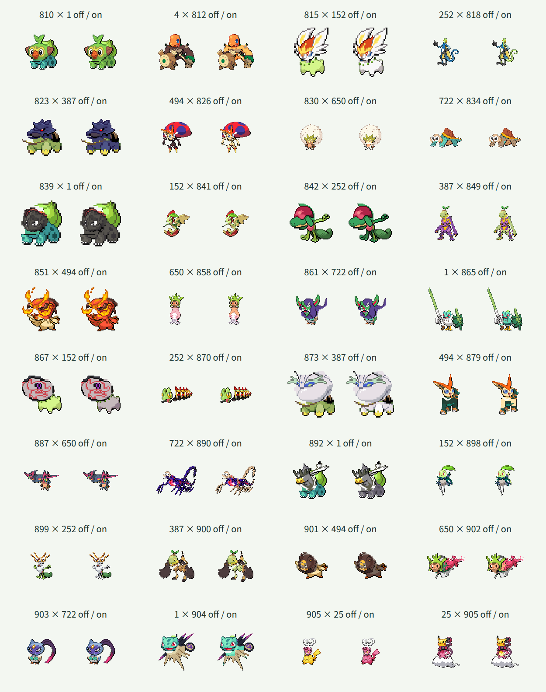

# 第8世代96種類の追加

## 対象と方針

全国図鑑No.0810〜0905の96種類を頭・体の両方に追加し、第1〜第8世代の905種類を選択できるようにしました。ヒスイ地方の新種No.0899〜0905も含め、保存済みの基本形を扱います。リージョンフォーム・キョダイマックス・別の姿は追加していません。

既存809種類の部位定義・接続情報・配色・PNG1618枚は維持しました。既存のJSON形式、素材生成、Canvas合成、検索・交換・ランダム選択を再利用し、Reactや実行時の仕組みは変更していません。

各元画像と抽出した頭・体を拡大して確認し、種ごとの頭の輪郭、接続点・幅、必要な体の補完、皮膚色と装飾の保護領域を定義しました。一律の水平分割は使っていません。目・輪郭・持ち物は皮膚色と区別しています。

## 検証方針

- 1〜905の欠番・重複、名前分割の復元、全819025通りの接続計算と出力余白を確認します。
- 追加前に第8世代の先頭・末尾とヒスイ地方の新種の検索、選択、交換、同種表示、ランダム末尾選択の境界テストが失敗することを確認します。
- 素材生成後、905種類・PNG1810枚と定義の一致、既存データ・素材の維持を検証します。
- 実Chromiumで追加96種類の同種合成を配色オン・オフで元画像と比較し、異種合成と配色保護を確認します。
- 実画面で検索・選択・交換・配色切替、狭い画面と通常幅の表示、フォーカスと文字コントラストを確認します。

## 形状上の制約

元画像に隠れた体積や陰影は復元しません。必要な接続補完には単色領域を使います。群体・多頭・道具状の種も元画像ごとに部位を定義し、極端な向きや比率を含む全組み合わせの見た目を保証するものではありません。

## 確認結果

| 確認項目 | 結果 |
| --- | --- |
| TDD | 追加前に範囲・接続計算・検索・ランダム末尾選択など6テストの失敗を確認。追加後は11ファイル・全989件が成功 |
| 対象と素材 | 1〜905の欠番・重複なし。名前分割は元名を復元。905種類・PNG1810枚と定義の一致を検証 |
| 既存素材の維持 | 809件の定義・部位情報が追加前のスナップショットと一致。既存PNG1618枚のSHA-256も変更なし |
| 接続計算 | 全819025通りが128×128出力の8ピクセルの余白に収まった |
| 実Canvas・同種 | 追加96種類の配色オン・オフ192枚が元画像のCanvasピクセルと一致 |
| 実Canvas・異種 | 追加96種類とフシギダネ・チコリータ・キモリ・ナエトル・ビクティニ・ハリマロン・モクローを頭・体の両方向、配色オン・オフで2688枚描画。全て可視ピクセルがあり、8ピクセルの余白を維持 |
| 配色の保護 | 追加96種類の体で、指定した対象外のRGBと全アルファ値が変換前後で一致 |
| 型検査・ビルド | 成功。JavaScriptは227.76kB、部位JSONは7038.79kB。チャンクサイズ警告なし |
| 元データ | 全国図鑑1〜1025の一覧1025件・元画像1025枚を検証。全画像96×96px |
| ビルド済み画面 | 頭・体それぞれ905候補、810・899・905番の全角番号・かな検索、選択・交換・同種表示・配色切替・ランダム・キーボード選択・0件での選択維持を確認 |
| テーマ診断 | Chromiumの幅360px・1280pxで横方向のはみ出しなし。30要素の文字コントラストは最小約6.1対1。矢印キーによる選択、3pxのフォーカス枠、Canvasのpixelated表示を確認 |
| 実行時の例外 | アプリケーションのJavaScript例外なし。Firefoxは未確認 |

実行したコマンドは `pnpm prepare:fusion`、`pnpm validate:fusion`、`pnpm test`、`pnpm build`（型検査を含む）、`pnpm validate:data` です。Canvas検証は開発サーバー上の実際の `renderFusion` と `recolorPixels` を使用し、画面操作は `pnpm preview` の静的ビルドで確認しました。

ヒスイ地方の新種7種類を含む下記32組の64枚を目視しました。見出しは頭×体、各欄の左が配色オフ、右がオンです。

## 形状ごとの扱い

- サルノリ系の棒・太鼓、鳥や虫の翼、カジリガメの甲羅、りんご、石炭山は体側に残します。バイウールーの角とひげは頭側です。
- タルップルは顔とリンゴ胴、サダイジャは顔と巻いた胴、茶器系は霊・上縁と器、デスバーンは顔の石片と残り、タイレーツは先頭個体の上部と後続群・足を分けます。ネギ・盾・杖は体側に残します。
- ブリムオンの長い髪と先端の手は頭側です。レドームシ・イオルブは顔の後ろに殻が残る構成です。
- アヤシシの角・ひげ、オオニューラの長い羽、ラブトロスのハート状触角は頭です。バサギリの斧、氷・爪・模様・雲などは体側に残して保護します。ウオノラゴンの左右のえらびれは頭に含めます。
- ラブトロスの名前分割は「ラブ」「トロス」です。

巻き胴・石片・群体、化石種の特殊な首、多頭・浮遊形状、長い装飾には元画像由来の比率や重なりの制約が残ります。隠れた大きな体積は復元せず、接続に必要な小領域だけを補完しています。全819025通りを目視で保証したものではありません。残る120種類の部位整備とFirefoxでの確認は未完了です。
