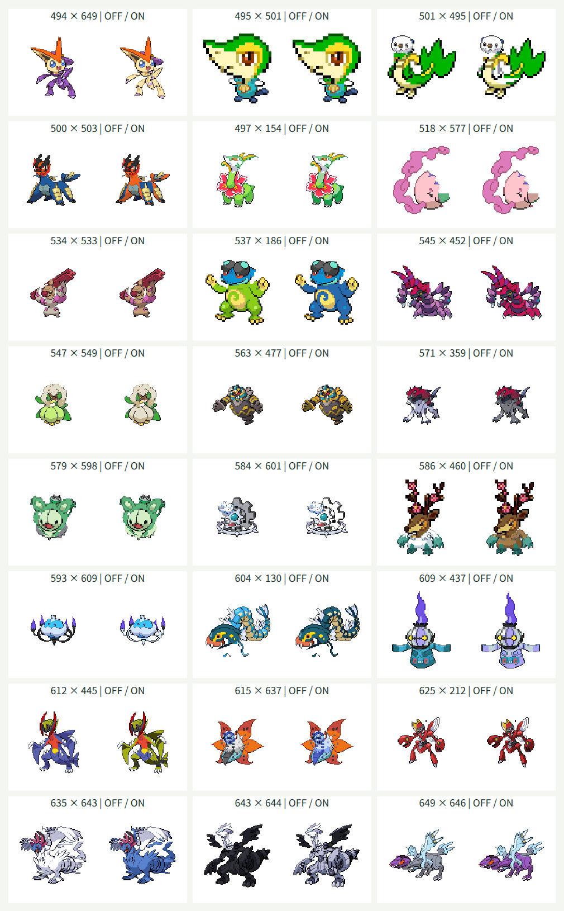

# 第5世代156種類の追加

この資料は第5世代へ拡張した時点の記録です。現在は[第9世代まで加えた1025種類](generation-nine.md)に対応しています。

## 対象と方針

全国図鑑No.0494〜0649の156種類を頭・体の両方に追加し、第1〜第5世代の649種類を選択できるようにしました。既存493種類の定義・部位情報・PNG986枚は維持し、素材生成・Canvas合成・独立JSONの読み込みを再利用しています。別の姿・フォルムは追加せず、保存済みの基本形を扱います。

各種の元画像を目視し、頭の多角形、接続点・幅、名前分割、補完領域、配色と保護領域を定義します。首のない形状、複数の顔、翼・武器・装飾・触手は種ごとに扱い、一律の横線では分割しません。目や輪郭だけの色は皮膚色から除外し、色を変えない装飾は可能な範囲で保護します。

## 検証方針

追加前に1〜649の網羅・名前復元、全421201通りの接続計算、末尾649番の検索・選択・交換・同種表示とランダム末尾選択のテストを更新して失敗を確認します。生成後は649種類・PNG1298枚の素材と接続・配色を検証します。

実ブラウザでは追加156種類を頭・体の両方として第1〜第4世代の代表と配色オン・オフで合成し、可視ピクセルと余白を確認します。同種同士は元画像とピクセル単位で比較し、配色対象外とアルファ値の維持も検証します。代表的な形状は目視し、幅360px・1280pxで検索・交換・配色切替・キーボード操作・横方向のはみ出しを確認します。

全421201通りの画質完成や1025種類への対応完了とは扱いません。単色の補完、前後の重なり、極端な比率や向き、皮膚と同じRGBを使う模様は引き続き調整対象です。

## 確認結果

| 確認項目 | 結果 |
| --- | --- |
| TDD | 追加前に範囲・全組み合わせ・末尾検索・ランダム選択の6テストの失敗を確認。追加後は全733件が成功した |
| 対象と素材 | 1〜649の欠番・重複なし。名前分割は元名と一致。PNG1298枚と接続・配色情報が定義に一致した |
| 既存素材の維持 | 493件の定義・部位情報が変更前と一致。PNG986枚のSHA-256も変更なし |
| 接続計算 | 全421201通りが128×128の出力領域の8ピクセルの余白に収まった |
| 実Canvas・同種 | 追加156種類を配色オン・オフで描画した312枚が元画像のCanvasピクセルと一致した |
| 実Canvas・異種 | 追加156種類とフシギダネ・チコリータ・キモリ・ナエトルを、頭・体の両方向、配色オン・オフで2496枚描画。可視ピクセルと8ピクセルの余白を確認した |
| 配色の保護 | 追加156種類の体で、指定した対象外のRGBと全アルファ値が変換前後で一致した |
| 代表例の目視 | 下記24組の配色オフ・オン48枚を確認した |
| 型検査・ビルド | 成功。JavaScriptは227.76kB、部位JSONは5090.22kB。チャンクサイズ警告なし |
| ビルド済み画面 | 649候補、494・649番の全角番号検索、かな検索、選択・交換・同種表示・配色切替・ランダム・キーボード選択・0件での選択維持を確認した |
| テーマ診断 | Chromiumの幅360px・1280pxで横方向のはみ出しなし。28要素の文字色と背景色から計算したコントラストは最小約6.1対1。Tab移動時の3pxのフォーカス枠とCanvasのpixelated表示を確認した |
| 実行時の例外 | 上記の描画・操作でJavaScript例外なし。Firefoxは未確認 |

素材準備のテストは引き続き図鑑番号ごとのケースとし、全649種類を検証します。全組み合わせの接続計算も対象を減らさず、描画矩形の最小・最大座標を集計して検証しています。

各欄の左が配色オフ、右がオンです。見出しの番号は頭×体です。

## 形状ごとの扱いと残る制約

- ビクティニは両耳を頭に含め、手と後ろの翼は体に残します。ジャローダは斜めの顔・飾りの境界で分け、とぐろと金色の体の装飾を体に残します。フタチマルの腰の貝、ダイケンキの脚・尾の装甲は体で保護しています。
- ムンナは顔の前側を頭、花模様を保護した後ろ側を体にします。ムシャーナは夢の煙を頭に含め、紫色の後ろ側を体にしています。首のない球形には丸い単色補完を使います。
- ココロモリ系は翼・尾を体に残し、ムーランドの長いひげ、タブンネの巻いた耳、ケンホロウの細い飾りは頭に含めます。
- ドテッコツ・ローブシンの持つ武器は体に残します。ハハコモリの葉のスカート、デスカーンの腕、化石組の甲羅・ひれ・翼、デスマスの金色の仮面は体に残して必要な領域を保護しています。エルフーンの綿、ドレディアの花、ゾロアークのたてがみは頭に含めます。
- ランクルスは頭の膜の突起を含めて切り出し、腕・色のついた内部の粒・下の膜は体に残します。バイバニラは両方の顔とストローを頭に含めます。ギアル系は小さい顔の歯車を頭、大きい歯車・輪を体にしています。
- ナットレイは顔の殻とつるを分け、見えなくなる殻を単色で補完します。シビルドンは開いた顎を頭に含めて腕や後ろのひれを除外します。シャンデラは中央の球体と炎を頭にし、4本の腕とその炎は体に残します。
- オノノクスの両方の牙、キリキザンの兜の飾りは頭に含めます。フリージオは中央の顔を頭、外側の結晶を体にしています。ジヘッドは2つの頭と共通の首を頭に含め、サザンドラは中央の頭だけを使います。腕の頭は体で保護しています。
- ウルガモス、レシラム、ゼクロムの翼、キュレムの翼の氷、トルネロス系の雲・尾は体に残します。レシラムの白、ゼクロムの暗い灰色は実際の体色として配色に使います。メロエッタは顔・飾り・長い髪を頭に含め、ゲノセクトは背中の砲台を体に残して保護しています。

顔と体が連続する形状、複数の顔、膜・歯車・つる、バッフロンの角と背中の重なりなどは単色の補完や元画像の向きの影響を受けます。隠れた陰影や立体構造は復元していません。極端な比率、皮膚と同じRGBの模様も調整対象で、全421201通りを目視で保証したものではありません。
