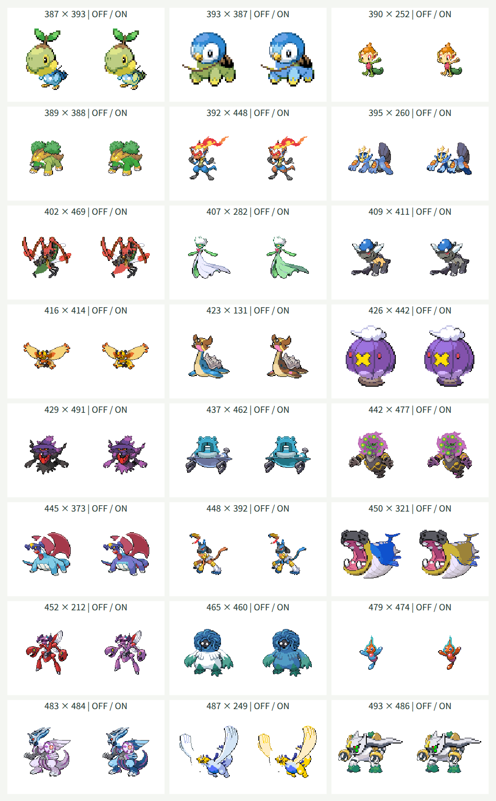

# 第4世代107種類の追加

この資料は第4世代へ拡張した時点の記録です。現在は[第9世代まで加えた1025種類](generation-nine.md)に対応しています。

## 対象と方針

全国図鑑No.0387〜0493の107種類を頭・体の両方に追加し、第1〜第4世代の493種類を選択できるようにしました。既存386種類の定義・部位情報・PNG772枚は維持し、素材生成・Canvas合成・独立JSONの読み込みを再利用しています。形態違いは増やさず、保存済みの基本形を扱います。

各種の元画像を確認して頭の多角形、接続点・幅、名前分割、補完領域、頭と体の配色・保護領域を定義します。首のない形状、装飾・翼・触手、前後に重なる部位は個別に切り分けます。一律の横線で分割する方式は使いません。

## 検証方針

追加前に1〜493の網羅・名前復元、全243049通りの接続計算、末尾493番の検索・選択・交換・同種表示とランダム末尾選択のテストを更新して失敗を確認します。生成後は493種類・PNG986枚の素材と接続・配色を検証します。

ブラウザでは追加107種類を頭・体の両方として第1〜第3世代の代表と配色オン・オフで合成します。同種同士は元画像のピクセルと比較し、配色対象外と透過の維持を検証します。代表的な形状を目視し、幅360px・1280pxで検索・交換・配色切替・キーボード操作・横方向のはみ出しを確認します。

全243049通りの画質完成や1025種類への対応完了とは扱いません。極端な頭と体の比率、向き、単色の補完、皮膚と同じRGBを使う模様は調整対象です。

## 確認結果

| 確認項目 | 結果 |
| --- | --- |
| TDD | 追加前に範囲・全組み合わせ・末尾検索・ランダム選択の6テストの失敗を確認。追加後は全577件が成功した |
| 対象と素材 | 1〜493の欠番・重複なし。名前分割は元名と一致。PNG986枚と接続・配色情報が定義に一致した |
| 既存素材の維持 | 386件の定義・部位情報が変更前と一致。PNG772枚のSHA-256も変更なし |
| 接続計算 | 全243049通りが128×128の出力領域の8ピクセルの余白に収まった |
| 実Canvas・同種 | 追加107種類を配色オン・オフで描画した214枚が元画像のCanvasピクセルと一致した |
| 実Canvas・異種 | 追加107種類とフシギダネ・チコリータ・キモリを、頭・体の両方向、配色オン・オフで1284枚描画。可視ピクセルと8ピクセルの余白を確認した |
| 配色の保護 | 追加107種類の体で、指定した対象外のRGBと全アルファ値が変換前後で一致した |
| 代表例の目視 | 下記24組の配色オフ・オン48枚を確認した |
| 型検査・ビルド | 成功。JavaScriptは227.76kB、部位JSONは3889.64kB。チャンクサイズ警告なし |
| ビルド済み画面 | 493候補、387・493番の全角番号検索、かな検索、選択・交換・同種表示・配色切替・ランダム・キーボード選択・0件での選択維持を確認した |
| テーマ診断 | Chromiumの幅360px・1280pxで横方向のはみ出しなし。28要素の文字色と背景色から計算したコントラストは最小約6.1対1。Tab移動時の3pxのフォーカス枠とCanvasのpixelated表示を確認した |
| 実行時の例外 | 上記の描画・操作でJavaScript例外なし。Firefoxは未確認 |

素材準備のテストは、全種を1ケースで検証すると5秒の上限を超えたため、同じ検証内容を図鑑番号ごとのケースへ分けました。対象を減らしたりタイムアウトを延ばしたりせず、各種の失敗を番号付きで報告します。ファイル・PNG・部位定義だけを扱うこのテストはNode環境で実行します。全組み合わせの接続計算は引き続き全件を走査して最小・最大座標で検証します。

各欄の左が配色オフ、右がオンです。見出しの番号は頭×体です。

## 形状ごとの扱いと残る制約

- ドダイトスの木・岩・甲羅・草は体に残して配色を保護し、甲羅の下の顔を頭にしています。ゴウカザルは炎を頭に含め、上げた腕は体に残します。炎に隠れた腕の形状は復元していません。
- エンペルトの三つ又の飾りと上向きの襟は頭、胸の模様は保護した体に残します。コロトックの触角・ひげ、ミノムッチ系の顔と吊り下がる部分は頭に含めています。
- ミツハニーは上の2つの顔を頭、下の顔と翼を体にしています。ジバコイルは中央の赤い目・ドーム・触角を頭にし、左右の白い顔と磁石は体に残します。ダイノーズも主な顔・帽子・鼻・ひげを頭にし、見える小鼻は体で保護します。
- ドーミラーは中央の顔と外周の板、ドータクンは冠・口と下の鐘・腕を分けます。ミカルゲは霊のまとまりを頭、要石を体にし、石の模様を保護しています。
- カバルドンは開いた口と上下の顎・牙を頭に含め、砂と背中は体に残します。ドラピオンは顔の顎と上げた前爪を分け、重なる腕の接続を単色で補完しています。
- モジャンボは中央の顔と上部のつるを頭、手足と下のつるを体にします。ロトムは上の顔・突起・周囲のオーラを頭にし、下の核と稲妻の腕を体に残して青いエネルギーを保護します。
- ギラティナは冠のある顔だけを頭にし、翼は体に残して保護します。クレセリアの三日月と顔、ダークライの白い頭部は頭に含め、リボンや赤い襟は体に残します。アルセウスは顔と長い頭の飾りを頭にし、金色の輪は体で保護しています。
- トリトドンは保存済みの「にしのうみ」、チェリムは閉じた姿、ギラティナは保存済みのアナザーフォルムを使用します。別の姿・フォルムは追加していません。

首のない板・鐘・霊の形状や、マンムーの牙の後ろ、ダイノーズの中央、モジャンボのつるの接続では単色の補完が見える場合があります。複数の顔が体に残る例、隠れた腕・装甲、極端な比率と向き、皮膚と同色の模様は調整対象です。全243049通りを目視で保証したものではありません。
