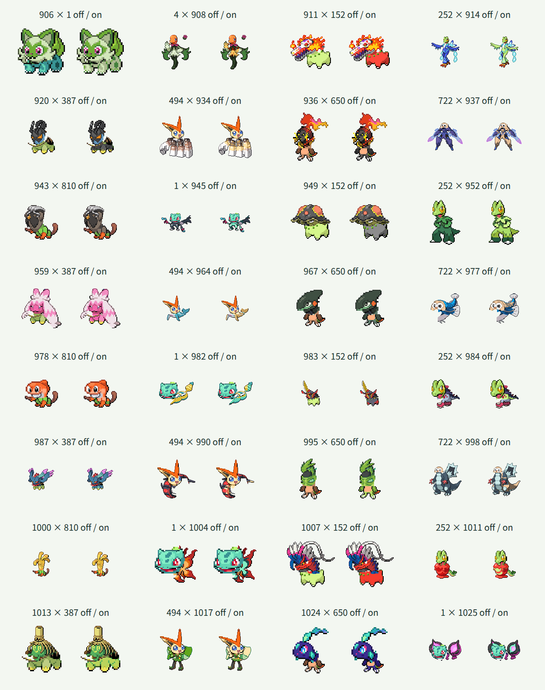

# 第9世代120種類の追加

## 対象と方針

全国図鑑No.0906〜1025の120種類を頭・体の両方に追加し、第1〜第9世代の全1025種類を選択できるようにしました。DLCの新種も含め、保存済みの基本形を扱います。リージョンフォーム・テラスタル・別の姿は追加していません。

既存905種類の部位定義・接続情報・配色・PNG1810枚は維持しました。既存のJSON形式、素材生成、Canvas合成、検索・交換・ランダム選択を再利用しています。全種の部位が揃ったため、画面から「1025種類への対応は準備中」の表示を削除しました。試作であることと、形・配色の調整中という説明は維持しています。

各元画像と抽出した頭・体を拡大して確認し、種ごとの頭の輪郭、接続点・幅、必要な体の補完、皮膚色と装飾の保護領域を定義しました。一律の水平分割は使っていません。目・輪郭・持ち物は皮膚色と区別しています。

## 検証方針

- 1〜1025の欠番・重複、名前分割の復元、全1050625通りの接続計算と出力余白を確認します。
- 追加前に第9世代の先頭・末尾とDLC新種の検索、選択、交換、同種表示、ランダム末尾選択の境界テストが失敗することを確認します。
- 素材生成後、1025種類・PNG2050枚と定義の一致、既存データ・素材の維持を検証します。
- 実Chromiumで全1025種類の同種合成を配色オン・オフで元画像と比較します。追加120種類と各既存世代の代表との異種合成、既存905種類と第9世代の代表との異種合成、全種の配色保護を確認します。
- 実画面で全1025候補、検索・選択・交換・配色切替、狭い画面と通常幅の表示、フォーカスと文字コントラストを確認します。

## 形状上の制約

元画像に隠れた体積や陰影は復元しません。必要な接続補完には単色領域を使います。群体・多頭・道具状の種も元画像ごとに部位を定義し、全種を選択できることと、全1050625通りの見た目の品質完成は区別します。

## 確認結果

| 確認項目 | 結果 |
| --- | --- |
| TDD | 追加前に範囲・接続計算・検索・ランダム末尾選択など6テストの失敗を確認。追加後は11ファイル・全1109件が成功 |
| 対象と素材 | 1〜1025の欠番・重複なし。名前分割は元名を復元。1025種類・PNG2050枚と定義の一致を検証 |
| 既存素材の維持 | 905件の定義・部位情報が追加前のスナップショットと一致。既存PNG1810枚のSHA-256も変更なし |
| 接続計算 | 全1050625通りが128×128出力の8ピクセルの余白に収まった |
| 実Canvas・同種 | 全1025種類の配色オン・オフ2050枚が元画像のCanvasピクセルと一致 |
| 実Canvas・追加種の異種合成 | 追加120種類とフシギダネ・チコリータ・キモリ・ナエトル・ビクティニ・ハリマロン・モクロー・サルノリを頭・体の両方向、配色オン・オフで3840枚描画。全て可視ピクセルがあり、8ピクセルの余白を維持 |
| 実Canvas・既存種の異種合成 | 既存905種類とニャオハを頭・体の両方向、配色オン・オフで3620枚描画。全て可視ピクセルがあり、8ピクセルの余白を維持 |
| 配色の保護 | 全1025種類の体で、指定した対象外のRGBと全アルファ値が変換前後で一致 |
| 型検査・ビルド | 成功。JavaScriptは227.69kB、部位JSONは7750.95kB。チャンクサイズ警告なし |
| 元データ | 全国図鑑1〜1025の一覧1025件・元画像1025枚を検証。全画像96×96px |
| ビルド済み画面 | 頭・体それぞれ1025候補、906・1011・1025番の全角番号・かな検索、選択・交換・同種表示・配色切替・ランダム・0件での選択維持を確認。準備中の説明がないことも確認 |
| キーボード | Home・矢印キーで先頭付近、Endで末尾1025番、上矢印で1024番を選択し、合成結果が更新された |
| テーマ診断 | Chromiumの幅360px・1280pxで横方向のはみ出しなし。29要素の文字コントラストは最小約6.1対1。3pxのフォーカス枠、Canvasのpixelated表示を確認 |
| 実行時の例外 | アプリケーションのJavaScript例外なし。Firefoxは未確認 |

実行したコマンドは `pnpm prepare:fusion`、`pnpm validate:fusion`、`pnpm test`、`pnpm build`（型検査を含む）、`pnpm validate:data` です。Canvas検証は開発サーバー上の実際の `renderFusion` と `recolorPixels` を使用し、画面操作は `pnpm preview` の静的ビルドで確認しました。

パラドックスポケモンとDLC新種を含む下記32組の64枚を目視しました。見出しは頭×体、各欄の左が配色オフ、右がオンです。

## 形状ごとの扱い

- ニャローテの花、マスカーニャの浮遊花・マント、ワナイダーの糸、虫の後脚、パモ系の尾・掌は体側に残します。ネズミ群体は手前右の成体の頭を抽出し、他個体・青い衣服を体側で保護します。
- オリーヴァの実と幹、パン系の襟・尾飾り、塩系の白い結晶・足場を保護します。コジオは前面の顔・岩帽と、後部岩・塩の足場を分けます。
- アノクサ系は中央の顔・枝を頭、外周の草輪を体に分けます。スコヴィランは両頭、ウミトリオは中央の頭を頭側にします。玉・ハンマー・岩・剣・塗料・腹部装飾は体側に残し、デカヌチャンの隠れた柄は細い二層の補完を使います。
- 魚の顎・ひげ、リキキリンのフード、イダイナキバの牙、ハバタクカミの長髪は頭です。スナノケガワは上部個体、テツノコウベは手前の主頭を分離し、残る顔を保護します。
- パオジアンの牙、ディンルーの器と角、各種の冠・触角を頭側に含めます。翼・サーフボード・茶器・リンゴ胴・甲羅などは体側に残します。モモワロウの名前分割は「モモ」「ワロウ」です。

ミニーブの小さい体、群体、草輪、長い髪、カミツオロチの交差する首、長い牙、開いた殻、頭の後方に重なる道具には元画像由来の比率・向き・重なりの制約が残ります。隠れた大きな体積は復元せず、接続に必要な小領域だけを補完しています。全種を頭・体として使う例は確認しましたが、全1050625通りを目視で保証したものではありません。形・配色の品質調整とFirefoxでの確認は未完了です。
