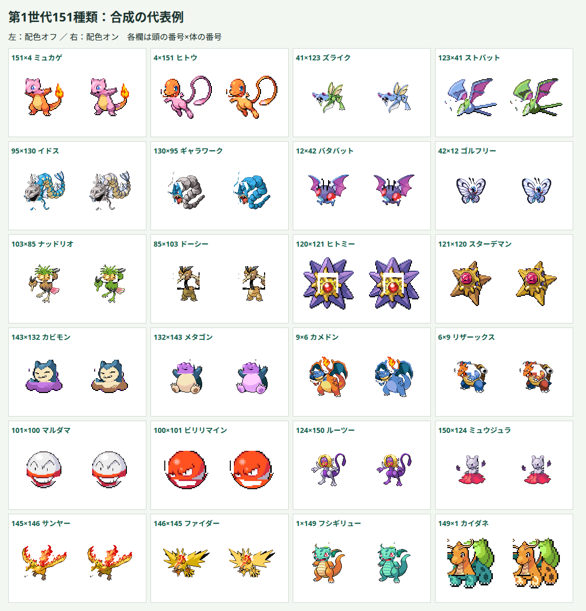

# 第1世代151種類のサンプル

この資料は第1世代へ拡張した時点の記録です。現在は[第3世代まで加えた386種類](generation-three.md)に対応しています。

## 対象と方針

全国図鑑No.0001〜0151を、頭と体の両方で選べる試作に拡張しました。既存6種類の定義を保持し、145種類を追加しました。元画像と合成処理は既存のものを使います。異種同士の22650通りと同種同士151通り、合計22801通りを生成できます。

種ごとに元画像を確認して頭の多角形、接続点・幅、補完領域、名前の前半・後半を定義しました。配色は定義した部位に実際にあるRGBから、色相と明るさで選んだ候補を保存しています。暗い輪郭や白い目をできるだけ除き、炎や襟などは保護領域で区別します。皮膚と同じRGBを使う模様や服には追加の調整が必要です。矩形で切り出せる頭もありますが、横一線で全種を分割する方法は使いません。複数の顔や頭と体が一体の種は、合体に使う顔の範囲を個別に指定します。

これはサンプル数の拡張です。単色の補完、元画像の向きの違い、残る顔や装飾、極端な頭と体の比率は調整対象です。全22801通りの画質が完成したとは扱いません。1025種類への拡張も引き続き準備中です。

## 検証

資料更新後に、1〜151の欠番・重複がないこと、各種の名前分割が元名に戻ること、部位の切出し・配色と全組み合わせの接続計算が成功することのテストを先に書き、欠番がある状態で失敗することを確認しました。生成済みのPNG302枚と接続・配色情報は既存の`pnpm validate:fusion`で定義との一致を検証します。

画面テストは151種類の候補、151番の検索・選択とランダム選択の末尾を確認します。ブラウザでは各種を頭・体として使う例と同種同士を確認し、形状の異なる代表例を目視します。幅360px・1280pxの表示、検索・交換・配色切替と実行時の例外を確認します。

## 確認結果と代表例

| 確認項目 | 結果 |
| --- | --- |
| 対象データ | 1〜151の定義・部位情報が番号順に揃い、名前の分割を連結すると元名と一致する |
| 素材検証 | 頭・体のPNG302枚と接続・配色情報が定義と一致する。最初の6種類の定義・部位情報・PNG12枚は変更なし |
| 自動テスト | 全85件が成功。全22801通りの接続計算で128×128の8ピクセルの余白に収まる |
| 型検査・ビルド | 当時は成功したが、約742kBのJavaScriptに500kB超の警告が出た。現在は部位情報を独立したJSONとして読み込み、この警告は解消済み（[開発環境](development.md)参照） |
| 実ブラウザの同種同士 | 151種類を配色オン・オフで描画した302枚が元画像のCanvasピクセルと一致する |
| 実ブラウザの異種同士 | 番号の隣同士とその逆、代表例を含む320通りをオン・オフで描画した640枚を確認。各種を頭・体の両方に使い、8ピクセルの余白を保つ |
| 配色の保護 | 異種320通りのうち315通りで色が変化した。変わったピクセルは指定領域内だけで、対象外とアルファ値は変化しない |
| 画面操作 | 151番の全角番号検索、選択・交換・キーボード選択、同種表示、配色切替、検索中の末尾のランダム選択を確認した |
| テーマ診断 | 幅360px・1280pxで横方向のはみ出しなし。文字コントラストは最小約6.1対1。フォーカス表示とEnterキーでの選択を確認した |
| 実行時の例外 | Edgeで上記942枚の描画と画面操作中にJavaScript例外なし。Firefoxは環境のプロファイル制約で未確認 |

元画像と生成した頭・体を全151種類で目視しました。ズバットとストライクの翼、モルフォンの触角、マタドガスの顔などは拡大して範囲を調整しました。

下の24例は各欄の左が配色オフ、右がオンです。見出しの番号は頭×体です。

## 残る品質上の制約

矩形の切り出しでは頭の端が直線になり、周囲の腕・羽・毛や小さなピクセルが体側に残る例があります。接続部の単色の補完や、異種の頭で隠しきれない穴も見えます。サンプルを見ながら多角形と補完領域を調整する必要があります。

ドードー・ドードリオ、ダグトリオ、レアコイルやガルーラの子などは、体に別の顔が残ります。ナッシーは葉と顔のまとまりを頭としています。星型は中央の顔・核と外側の腕を切り分けています。構造の違う種同士のつながりや、皮膚と同色の模様・服の配色は、全22801通りを保証していません。
