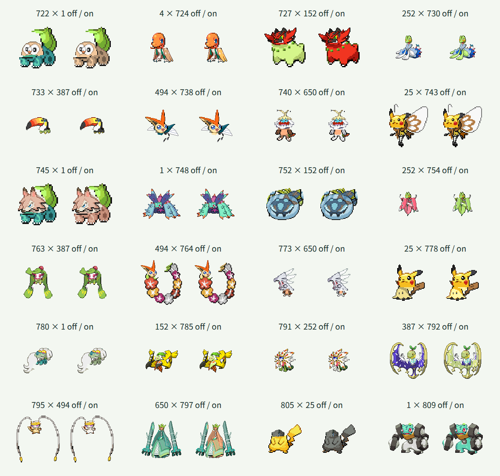

# 第7世代88種類の追加

この資料は第7世代へ拡張した時点の記録です。現在は[第8世代まで加えた905種類](generation-eight.md)に対応しています。

## 対象と方針

全国図鑑No.0722〜0809の88種類を頭・体の両方に追加し、第1〜第7世代の809種類を選択できるようにしました。メルタン・メルメタルを含め、保存済みの基本形を扱います。リージョンフォームなどの別の姿は追加していません。

既存721種類の部位定義・接続情報・配色・PNG1442枚は維持しました。既存のJSON形式、素材生成、Canvas合成、検索・交換・ランダム選択を再利用し、Reactや実行時の仕組みは変更していません。

各元画像と抽出した頭・体を拡大して確認し、種ごとの頭の輪郭、接続点・幅、必要な体の補完、皮膚色と装飾の保護領域を定義しました。一律の水平分割は使っていません。目・輪郭・持ち物は皮膚色と区別しています。

## 検証方針

- 1〜809の欠番・重複、名前分割の復元、全654481通りの接続計算と出力余白を確認します。
- 追加前に第7世代の先頭・末尾の検索、頭・体への選択、交換、同種表示、ランダム末尾選択のテストが失敗することを確認します。
- 素材生成後、809種類・PNG1618枚と定義の一致、既存データ・素材の維持を検証します。
- 実Chromiumで追加88種類の同種合成を配色オン・オフで元画像と比較し、異種合成と配色保護を確認します。
- 実画面で検索・選択・交換・配色切替、狭い画面と通常幅の表示、フォーカスと文字コントラストを確認します。

## 形状上の制約

元画像に隠れた体積や陰影は復元しません。必要な接続補完には単色領域を使います。浮遊体・多頭・道具状の種も元画像ごとに部位を定義し、極端な向きや比率を含む全組み合わせの見た目を保証するものではありません。

## 確認結果

| 確認項目 | 結果 |
| --- | --- |
| TDD | 追加前に範囲・接続計算・検索・ランダム末尾選択など6テストの失敗を確認。追加後は11ファイル・全893件が成功 |
| 対象と素材 | 1〜809の欠番・重複なし。名前分割は元名を復元。809種類・PNG1618枚と定義の一致を検証 |
| 既存素材の維持 | 721件の定義・部位情報が追加前のスナップショットと一致。既存PNG1442枚のSHA-256も変更なし |
| 接続計算 | 全654481通りが128×128出力の8ピクセルの余白に収まった |
| 実Canvas・同種 | 追加88種類の配色オン・オフ176枚が元画像のCanvasピクセルと一致 |
| 実Canvas・異種 | 追加88種類とフシギダネ・チコリータ・キモリ・ナエトル・ビクティニ・ハリマロンを頭・体の両方向、配色オン・オフで2112枚描画。全て可視ピクセルがあり、8ピクセルの余白を維持 |
| 配色の保護 | 追加88種類の体で、指定した対象外のRGBと全アルファ値が変換前後で一致 |
| 型検査・ビルド | 成功。JavaScriptは227.76kB、部位JSONは6360.56kB。チャンクサイズ警告なし |
| 元データ | 全国図鑑1〜1025の一覧1025件・元画像1025枚を検証。全画像96×96px |
| ビルド済み画面 | 頭・体それぞれ809候補、722・808・809番の全角番号・かな検索、選択・交換・同種表示・配色切替・ランダム・キーボード選択・0件での選択維持を確認 |
| テーマ診断 | Chromiumの幅360px・1280pxで横方向のはみ出しなし。30要素の文字コントラストは最小約6.1対1。矢印キーによる選択、3pxのフォーカス枠、Canvasのpixelated表示を確認 |
| 実行時の例外 | アプリケーションのJavaScript例外なし。Firefoxは未確認 |

実行したコマンドは `pnpm prepare:fusion`、`pnpm validate:fusion`、`pnpm test`、`pnpm build`（型検査を含む）、`pnpm validate:data` です。Canvas検証は開発サーバー上の実際の `renderFusion` と `recolorPixels` を使用し、画面操作は `pnpm preview` の静的ビルドで確認しました。

下記24組の48枚を目視しました。見出しは頭×体、各欄の左が配色オフ、右がオンです。

## 形状ごとの扱い

- ジュナイパーのフード、アシレーヌの髪、クワガノンの大顎は頭です。翼・上翅・脚、ケケンカニの拳、バンバドロの泥は体側に残します。
- 水泡・触角・葉髪・冠・拘束具・ミミッキュの偽の耳は頭です。花輪・扇・ボール・丸太・甲羅・木の尾・ひれは体側に残し、必要な装飾を配色から保護します。
- ジジーロンのひげ、ジャラコ系の冠、守り神の頭飾り・髪、ソルガレオのたてがみ、フェローチェの長い触角を頭に含めます。
- ダダリンの錨、ルナアーラの翼、アーゴヨンの翼・腕・針、メルメタルの胸・肩・拳のナットは体に残します。メルメタルの名前分割は「メル」「メタル」です。
- アクジキングは上部の小さい顔を頭、巨大な腹の口を体として保護します。ツンデツンデは上部の石積みを頭、下部と脚を体に分けます。

水泡裏の脚や頸部、球形・砂山の隠れた部分は単色補完です。長いひげ・触角、葉と腕の重なり、小さい顔、極端な頭と体の比率や向き、皮膚と同じRGBの模様には制約が残ります。全654481通りを目視で保証したものではありません。残る216種類の部位整備とFirefoxでの確認は未完了です。
