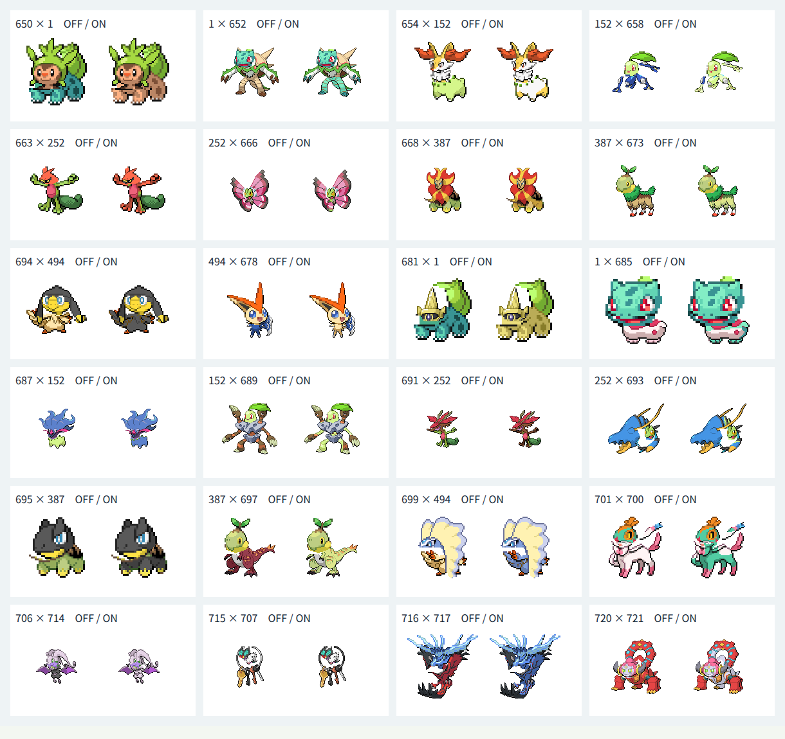

# 第6世代72種類の追加

この資料は第6世代へ拡張した時点の記録です。現在は[第8世代まで加えた905種類](generation-eight.md)に対応しています。

## 対象と方針

全国図鑑No.0650〜0721の72種類を頭・体の両方に追加し、第1〜第6世代の721種類を選択できるようにしました。既存649種類の定義・部位情報・PNG1298枚を維持し、既存の素材生成・Canvas合成・独立JSONを再利用しています。別の姿・フォルムは追加せず、保存済みの基本形を扱います。721番の名前分割は「ボル」「ケニオン」です。Reactや実行時のスキーマは変更していません。

各96px元画像と抽出部位を拡大して目視し、種ごとの輪郭・接続点・補完領域・配色・保護領域を定義しました。一律の水平分割は使いません。目だけの白や輪郭だけの暗色は皮膚色に含めず、装飾を可能な範囲で保護しています。

## 検証方針

追加前に1〜721の網羅・名前復元、全519841通りの接続計算、末尾721番の全角番号・かな検索、選択・交換・同種表示とランダム末尾選択のテストを更新して失敗を確認しました。生成後は721種類・PNG1442枚の素材と接続・配色を検証しています。

実Chromiumでは追加72種類の同種合成を配色オン・オフで144枚描画し、元画像とのピクセル一致を確認しました。代表1・152・252・387・494との両方向、配色オン・オフの異種1440枚で可視ピクセルと128px出力の8px余白を確認し、配色対象外RGBとアルファ値も比較しています。代表24組の配色オフ・オンを画像に記録して目視しました。

## 確認結果

| 確認項目 | 結果 |
| --- | --- |
| TDD | 追加前に範囲・全組み合わせ・末尾検索・ランダム選択など6テストの失敗を確認。追加後は11ファイル・全805件が成功した |
| 対象と素材 | 1〜721の欠番・重複なし。名前分割は元名と一致。PNG1442枚と接続・配色情報が定義に一致した |
| 既存素材の維持 | 649件の定義・部位情報が追加前のスナップショットと一致。既存PNG1298枚のSHA-256も変更なし |
| 接続計算 | 全519841通りが128×128出力の8ピクセルの余白に収まった |
| 実Canvas・同種 | 追加72種類の配色オン・オフ144枚が元画像のCanvasピクセルと一致した |
| 実Canvas・異種 | 追加72種類とフシギダネ・チコリータ・キモリ・ナエトル・ビクティニを頭・体の両方向、配色オン・オフで1440枚描画。全て可視ピクセルがあり、8ピクセルの余白を維持した |
| 配色の保護 | 追加72種類の体で、指定した対象外のRGBと全アルファ値が変換前後で一致した |
| 代表例の目視 | 下記24組の配色オフ・オン48枚を確認した。エリキテルの尾の接続、ルチャブルの冠、化石組の顎の取り残しは抽出段階で修正した |
| 型検査・ビルド | 成功。JavaScriptは227.76kB、部位JSONは5684.13kB。チャンクサイズ警告なし |
| 元データ | 全国図鑑1〜1025の一覧1025件・元画像1025枚を検証。全画像96×96px |
| ビルド済み画面 | 721候補、650・721番の全角番号・かな検索、選択・交換・同種表示・配色切替・ランダム・キーボード選択・0件での選択維持を確認した |
| テーマ診断 | Chromiumの幅360px・1280pxで横方向のはみ出しなし。30要素の文字色・背景色から計算したコントラストは最小約6.1対1。矢印キーによる選択、3pxのフォーカス枠、Canvasのpixelated表示を確認した |
| 差分 | `git diff --check`成功 |
| 実行時の例外 | 正しい候補の出現を待つ最終操作ではJavaScript例外なし。最初の自動操作で候補更新前に選択した際の例外は操作スクリプトを修正して切り分けた。Firefoxは未確認 |

実行したコマンドは `pnpm prepare:fusion`、`pnpm validate:fusion`、`pnpm test`、`pnpm build`（`pnpm typecheck`を含む）、`pnpm validate:data`、`git diff --check`です。素材準備は引き続き図鑑番号ごとのケースで全721種類を検証し、接続計算は全519841通りを対象としています。ブラウザのCanvas検証は実際の`renderFusion`と`recolorPixels`を読み込んで実施し、画面操作は静的ビルドの`pnpm preview`で確認しました。

各欄の左が配色オフ、右がオンです。見出しの番号は頭×体です。

## 形状ごとの扱いと残る制約

- ハリボーグ系の顔と殻を分け、ブリガロンの背中の殻は体で保護しています。テールナー・マフォクシーの耳は頭、杖と炎は体に残します。ゲッコウガの舌のマフラーは頭に含めます。
- ファイアローの翼と尾、ビビヨンの翼は体に残し、ビビヨンの触角は頭に含めます。カエンジシのたてがみの裏の胸は平らな黄褐色で補完しています。フラージェスの花と巻いた部分は頭、葉と腕は体です。トリミアンの頭のたてがみと尾、ニャオニクスの耳・顔と尾・腕を分けています。
- ヒトツキ・ニダンギル・ギルガルドは各元画像を個別に定義しています。ニダンギルの柄の接続補完は単色の金色で、隠れた柄や刃の構造を復元するものではありません。
- マーイーカの上の覆いと顔を頭、下の触手と腕を体にし、カラマネロの長い横の触手は体に残します。カメテテは両方の顔を頭、岩を体にし、ガメノデスは中央の顔だけを頭、周囲の4つの手の顔を体で保護しています。
- ドラミドロの赤い冠と口は頭、枝状の腕と巻いた尾は体です。ウデッポウ・ブロスターの顔と触角を大きなはさみから分け、ブロスターの砲台状のはさみと尾は体で保護しています。
- エリキテルの垂れた耳は頭、尾は体に残し、耳に隠れた尾の接続は細い黄色で補完しています。エレザードの首の襟と長い尾は体です。化石組の冠・顎・ひれ状の飾りは頭、脚と尾は体です。ニンフィアの頭のリボンと胸のリボン・尾を分け、ルチャブルの冠と顔は頭、翼は体に残しています。
- ヌメラ系の顔・触角を頭、殻・尾・粘液の模様を体にします。クレッフィの顔と上の突起・小さい飾りを頭、輪と鍵を体にし、鍵を保護しています。ボクレー・オーロットの顔と角状の枝は頭、枝の腕と根は体です。バケッチャの霊の頭とカボチャを分け、パンプジンの長い髪と腕は頭に含めます。
- カチコールの前の顔と後ろの氷、クレベースの前の顔と大きな氷の台・脚を分けます。オンバット・オンバーンの耳と顔は頭、翼・尾は体で保護しています。ゼルネアスの角と顔は頭、胸・脚・尾は体、イベルタルの灰色の冠と長い顔は頭、翼と尾は体です。
- ジガルデは上の扇状の覆いと顔を頭、緑の蛇状の胴体を体にします。ディアンシーの冠・顔・垂れた桃色の飾りは頭、石のスカートは体です。フーパの角・顔・輪は頭、下の輪と腕は体にし、ボルケニオンの顔と横の角は頭、背中の蒸気の輪・脚は体で保護しています。

顔と体が連続する種、浮遊体、氷・霊・カボチャの境界では小さい単色補完を使い、隠れた体積・陰影や前後関係を復元していません。オーロット・パンプジンの細い枝や髪、カエルの泡やマフラー、ゴーゴートの葉やひげ、蝶の触角と翼の重なりには元画像の向きによる制約があります。白い氷・粘液や暗い実際の皮膚は配色に使いますが、皮膚と同じRGBの模様、極端な頭と体の比率や向きも引き続き調整対象です。全519841通りを目視で保証したものではありません。残る304種類の部位整備とFirefoxでの確認は未完了です。
