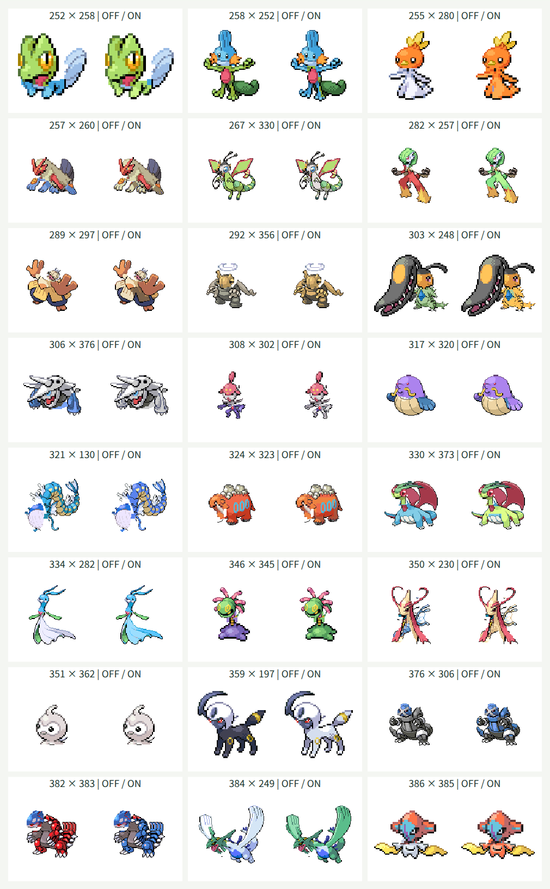

# 第3世代135種類の追加

## 対象と方針

全国図鑑No.0252〜0386の135種類を頭・体の両方に追加し、第1・第2世代と合わせて386種類を選択できるようにしました。既存251種類の定義・部位情報・PNG502枚を維持し、元画像、素材生成、Canvas合成、独立JSONの読み込みを再利用しています。

種ごとに元画像を確認して頭の多角形、接続点・幅、名前分割、補完領域、配色と保護領域を定義します。首のない種や複数の顔、翼・触手・殻などは個別に範囲を判断します。形態違いは追加せず、保存済みの基本形を使います。

全148996通りの接続計算を検証しますが、全組み合わせの画質完成とは扱いません。向き・極端な比率・単色補完や皮膚と同じRGBの模様は調整対象です。

## 検証方針

追加前に範囲と名前復元、全組み合わせの収まり、末尾386番の検索・選択・交換・同種表示、ランダム末尾選択のテストを更新して失敗を確認します。生成後は386種類・PNG772枚と接続・配色を検証します。

実ブラウザで追加135種類を頭・体の両方として配色オン・オフで描画し、同種同士は元画像のピクセルと比較します。形状の異なる代表例を目視し、幅360px・1280pxの検索・選択・交換・配色切替、キーボード操作と横方向のはみ出しを確認します。

## 確認結果

| 確認項目 | 結果 |
| --- | --- |
| TDD | 追加前に範囲・全組み合わせ・末尾検索・ランダム選択の6テストの失敗を確認。追加後は全85件が成功した |
| 素材検証 | 1〜386の欠番・重複なし。名前分割は元名と一致。PNG772枚と接続・配色情報が定義に一致した |
| 既存素材の維持 | 251件の定義・部位情報が変更前と一致。PNG502枚のSHA-256も変更なし |
| 接続計算 | 全148996通りが128×128の出力領域の8ピクセルの余白に収まった |
| 実Canvas・同種 | 追加135種類を配色オン・オフで描画した270枚が、元画像のCanvasピクセルと一致した |
| 実Canvas・異種 | 追加135種類とフシギダネ・チコリータを、頭・体の両方向、配色オン・オフで1080枚描画。可視ピクセルと8ピクセルの余白を確認した |
| 配色の保護 | 追加135種類の体で、対象外RGBと全アルファ値が変換前後で一致した |
| 代表例の目視 | 下記24組の配色オフ・オン48枚を確認した |
| 型検査・ビルド | 成功。JavaScriptは227.76kB、部位JSONは3141.39kB。チャンクサイズ警告なし |
| ビルド済み画面 | 386候補、252・386番の全角番号検索、かな検索、選択・交換・同種表示・配色切替・ランダム・キーボード選択・0件での選択維持を確認した |
| テーマ診断 | Chromiumの幅360px・1280pxで横方向のはみ出しなし。文字色と背景色から計算したコントラストは28要素で最小約6.1対1。Tab移動時の3pxのフォーカス枠と、Canvasのpixelated表示を確認した |
| 実行時の例外 | 上記の描画と操作でJavaScript例外なし。Firefoxは未確認 |

全組み合わせのテストは、各描画矩形の最小・最大座標を集計して余白を検証します。組み合わせごとの大量のアサーションで5秒の上限を超えたため、対象148996通りと検証する境界を維持したまま集計方式に変更しました。

各欄の左が配色オフ、右がオンです。見出しの番号は頭×体です。

## 形状ごとの扱いと残る制約

- ミズゴロウの頭は頬のひれ・頭頂のひれを含め、尻尾は体に残します。ボーマンダは頭の後ろに重なる翼を体側へ残すよう境界を調整しました。
- クチートは前の顔・触角・後ろの大顎を頭に含め、手足を体に残しています。後ろ顎が大きいため、異種の体との比率が極端になる例があります。
- コータスは頭と見えている首を切り出し、煙と甲羅を体に残して配色を保護します。煙に隠れた首の形状は元画像から復元できません。
- ホエルオーは前側の顔、ルナトーンは三日月の顔の領域、ソルロックは上側の顔と光条を頭にしています。首のない形状では切れ目や単色の補完が見えます。
- メタング・メタグロスは中央の顔、レジ系は目の点模様を含む上部を頭にします。脚・腕と中央の接続部の単色補完には立体感の限界があります。
- ヌケニンは輪と顔を頭に含めます。ミロカロスの長いひれ、ダーテングのたてがみと拳、ケッキングの寝た姿勢など、前後に重なる部位や向きの違いは引き続き調整対象です。
- デオキシスは保存済みの通常形を使用し、胸の核は体に残して配色を保護します。ポワルンなども天候や形態違いは追加していません。

全組み合わせを目視で保証したものではありません。皮膚と同じRGBを使う模様の配色、極端な頭と体の比率、向き、単色の補完は試作の品質上の制約です。
