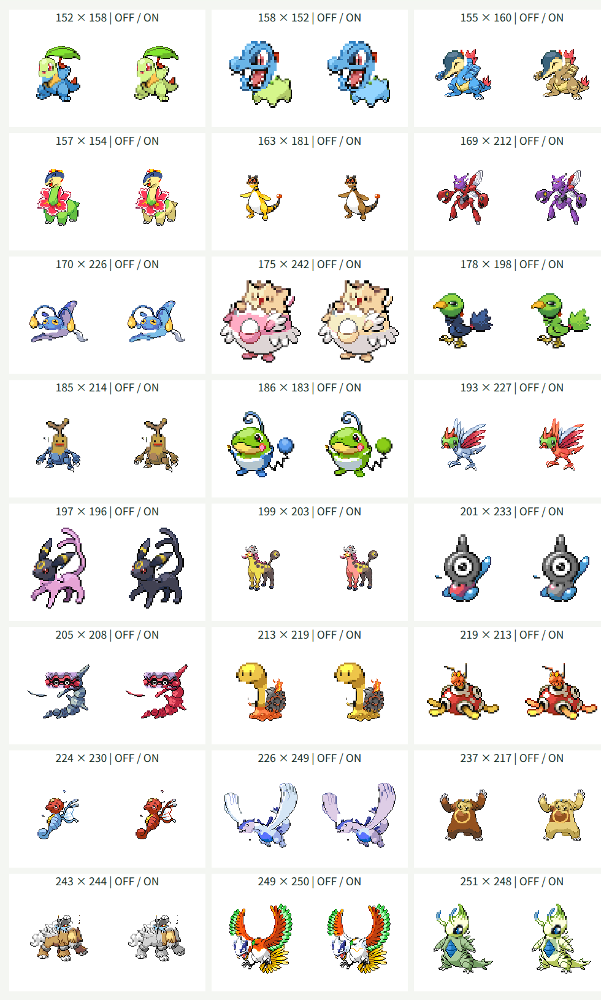

# 第2世代100種類の追加

この資料は第2世代へ拡張した時点の記録です。現在は[第3世代まで加えた386種類](generation-three.md)に対応しています。

## 対象と方針

全国図鑑No.0152〜0251の100種類を頭・体の両方として追加し、第1世代と合わせて251種類を選べるようにしました。元画像・素材生成・Canvas合成・JSONの非同期読み込みは既存の仕組みを使い、第1世代の定義を維持しています。

元画像を種ごとに確認し、頭の多角形、接続点・幅、名前分割、補完領域、頭と体の配色を指定します。耳・角・葉・炎などを含める範囲は個別に判断します。複数の頭や顔がある種は主な顔を合体用の頭とし、体に別の顔が残る制約を記録します。配色は切り出した部位に存在するRGBを使い、目・輪郭・装飾を可能な範囲で保護します。

251種類の試作への拡張であり、全63001通りの画質完成や1025種類への対応完了とは扱いません。単色補完、元画像の向き、極端な比率、皮膚と同色の模様は引き続き調整対象です。

## 検証方針

実装前に対象範囲・名前の復元・全組み合わせの接続計算、および末尾251番の検索・選択・交換とランダム選択のテストを更新します。生成後に素材502枚と接続・配色情報を検証します。

ブラウザでは追加100種類をそれぞれ頭・体として描画し、同種同士の元画像表示も確認します。代表的な形状の合成は目視します。幅360px・1280pxで検索・交換・配色切替と横方向のはみ出し、実行時の例外を確認します。

## 確認結果

| 確認項目 | 結果 |
| --- | --- |
| TDD | 追加前に範囲・全組み合わせ・画面の末尾検索とランダム選択の6テストが失敗し、追加後は全85件が成功した |
| 対象と素材 | 1〜251の欠番・重複なし。名前分割を連結すると元名と一致。PNG502枚と接続・配色情報が素材検証を通った |
| 第1世代の維持 | 定義151件・部位情報151件が変更前と一致。PNG302枚のSHA-256も変更なし |
| 接続計算 | 自動テストで全63001通りが128×128の出力領域の8ピクセルの余白に収まった |
| 実Canvas・同種 | 第2世代100種類を配色オン・オフで描画した200枚が、それぞれ元画像のピクセルと一致した |
| 実Canvas・異種 | 追加100種類とフシギダネを頭・体の両方向で配色オン・オフにして400枚描画。可視ピクセルと8ピクセルの余白を確認した |
| 代表例の目視 | 下記24組の配色オフ・オン48枚を確認した |
| 型検査・ビルド | 成功。JavaScriptは227.76kB、部位JSONは2188.43kB。チャンクサイズ警告なし |
| ビルド済み画面 | 251候補、152・251番の全角番号検索、かな検索、選択・交換・配色切替・同種表示・ランダム操作・キーボード選択・0件での選択維持を確認した |
| 表示と例外 | Chromiumの幅360px・1280pxで横方向のはみ出しなし。実行時のJavaScript例外なし。Firefoxは未確認 |

各欄の左が配色オフ、右がオンです。見出しの番号は頭×体です。

## 形状ごとの扱いと残る制約

- キリンリキは前側の顔を頭にし、尻尾の顔は体に残して配色を保護しています。ヤドキングの王冠は頭に含めています。
- クロバットは中央の顔、フォレトスは目のある中央帯を頭にします。翼の付け根や殻との接続は単色補完のため、自然な立体形状の再現には限界があります。
- ツボツボは頭と長い首、オクタンは頭部と口を切り出します。殻や触手は体に残ります。
- チョンチー・ランターンの触角、ルギアの冠と口、ホウオウの冠・顔・くちばしは頭に含めています。大きな翼は体に残ります。
- トゲピー・ネイティ・ヒマナッツ・アンノーン・マンタイン・サナギラスなど、首のない連続した形状は切れ目が目立つ場合があります。カポエラーは倒立した元画像の向きを維持しています。
- 炎・葉のスカート・襟・羽・殻は配色候補から除外するか保護領域にしていますが、同じRGBを使う模様や目の配色には引き続き調整の余地があります。

全63001通りを目視で保証したものではありません。極端な頭と体の比率や向き、単色の接続補完は試作の品質上の制約です。
